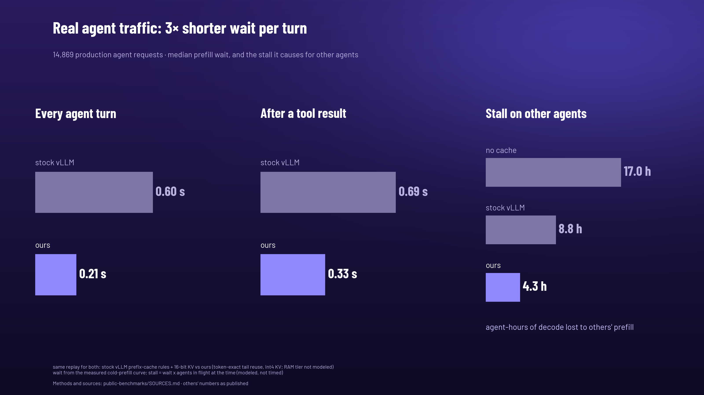
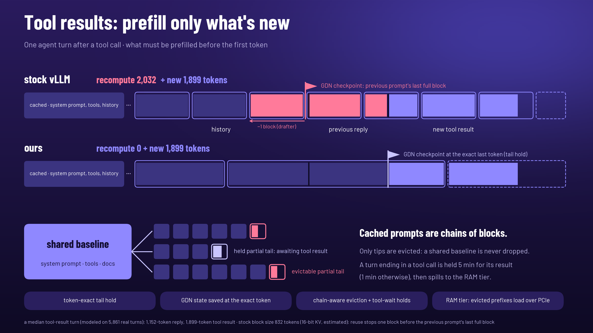
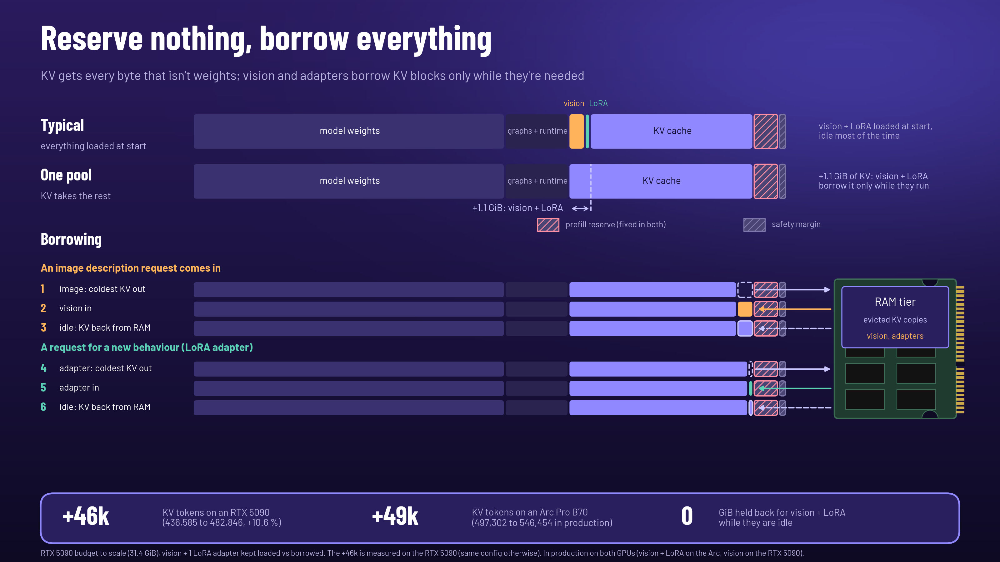
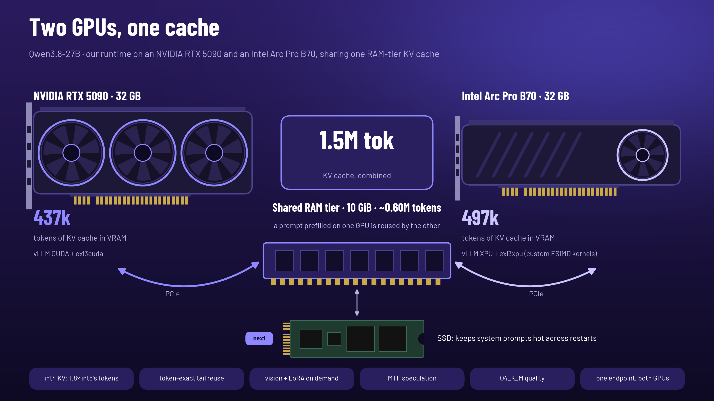
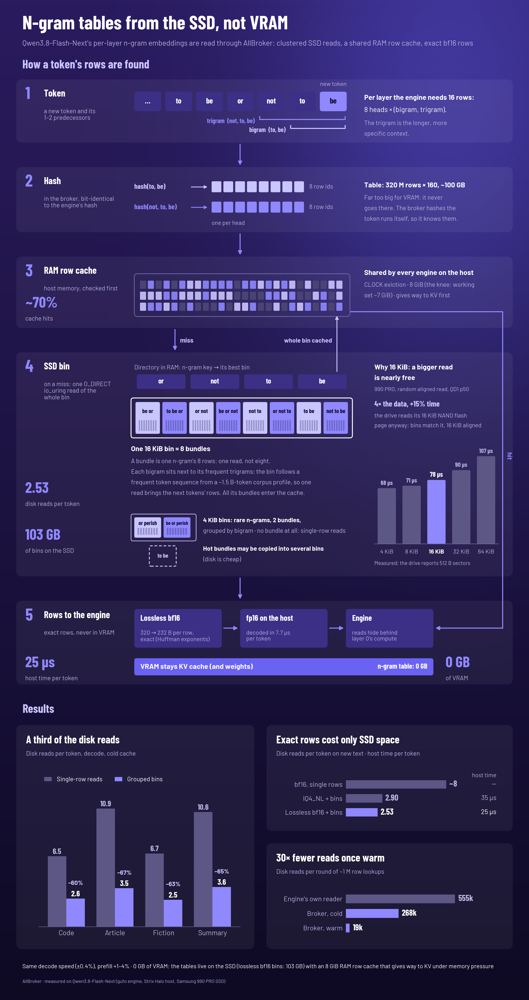

# AllBroker

**A broker that loads and unloads KV, mmproj, and LoRA to and from VRAM at runtime.**

AllBroker is a host-side cache service for LLM inference engines. It gives every engine on a machine one shared,
memory-managed tier below VRAM: host RAM first, then an SSD. Engines hand it what doesn't fit in VRAM and get it
back on the next turn, the next request, or the next start, without recomputing it.

It is built for agent workloads: tool calls, long contexts, several agents at once, where most of each prompt was
already seen on an earlier turn. It runs together with a vLLM fork and an EXL3 kernel plugin (see
[Companion repos](#companion-repos)); [AllRunner](https://github.com/echowarp/AllRunner) builds and runs the whole stack.

## Results



Replay of 14,869 production agent requests: median prefill wait per turn 0.21 s vs 0.60 s with stock vLLM prefix
caching and 16-bit KV (after a tool result 0.33 s vs 0.69 s), and 4.3 instead of 8.8 agent-hours of decode lost to
other agents' prefills (17.0 without a cache). Modeled from the measured cold-prefill curve, not timed; this replay
does not model the RAM tier, so it shows the tail hold and int4 KV. On real agent traffic the RAM tier supplied 2.6 %
of prompt tokens, the GPU prefix cache 59.7 %.



For a median tool-result turn (modeled on 5,861 real turns: a 1,152-token reply, then a 1,899-token tool result),
stock vLLM's block-rounded prefix cache recomputes 2,032 tokens before the new ones; with the token-exact tail hold
only the 1,899 new tokens are prefilled. The hold itself is in [echowarp/vllm](https://github.com/echowarp/vllm); the
broker keeps partial tails with their GDN state when they spill to RAM.



VRAM is KV by default: the vision tower and LoRA adapters borrow the coldest KV blocks while they run (the evicted
blocks' copies stay in the RAM tier) and give them back. The lazy vision tower, packed KV and vision lending together
raised one GPU's KV cache from 436,585 to 482,846 tokens (+10.6 %), same configuration otherwise.



Engines on different GPUs map one host-RAM pool (here 10 GiB: 186 slots of 3,200 tokens, at most about 0.60M tokens,
since GDN-state entries share the slots), so a prefix one GPU prefilled can be loaded by the other. The SSD tier is
marked "next": it is in this repo, but the measured deployment runs without it.



For models with large n-gram embedding tables (Qwen3.8-Flash-Next: ~100 GB, 16 rows per token per layer), the broker
serves the rows from the SSD through a shared RAM row cache and never puts them in VRAM. Grouped bins cut disk reads
per token by 60–67 %, exact (losslessly compressed bf16) rows need fewer reads than 4-bit ones, and decode speed is
unchanged. Measured with the gufo engine on a Strix Halo host; details in [docs/ngram-tables.md](docs/ngram-tables.md).

Measured with Qwen3.8-27B EXL3 4.0 bpw and int4 KV in the [AllRunner](https://github.com/echowarp/AllRunner)
deployment (one NVIDIA and one Intel GPU on one broker). The charts are generated in AllRunner
([benchmarks/charts](https://github.com/echowarp/AllRunner/tree/main/benchmarks/charts)); methods and sources are in its
[benchmarks/README.md](https://github.com/echowarp/AllRunner/blob/main/benchmarks/README.md).

## Parts

AllBroker has three parts, each usable on its own:

| Part | What it does | Where |
|---|---|---|
| **KV broker** (`llmt-kvbroker`) | shared, memory-managed host-RAM (and SSD) tier for KV cache entries, across engines and GPUs | `crates/broker`, `crates/core` |
| **Weight keeper** (`llmt-keeper` + `llmt_kv.whx_loader`) | restart a vLLM engine in seconds: weights stay resident in GPU memory across engine restarts | `crates/keeper`, [docs/keeper.md](docs/keeper.md) |
| **vLLM plugin** (`llmt_kv`) | the KV-tier connector, the keeper loader, the lazy vision tower and the lend manager (VRAM lent from KV to LoRA adapters and the vision tower, returned when they are done) | `crates/py`, [docs/vllm-plugin.md](docs/vllm-plugin.md), [docs/lend.md](docs/lend.md) |

## Companion repos

The results above come from AllBroker running with these repos. Use them together; the image builds in AllRunner pin
a tested commit of each.

| Repo | Branch | What AllBroker gets from it |
|---|---|---|
| [echowarp/vllm](https://github.com/echowarp/vllm) | `publish-20261113-cuda` (NVIDIA) / `publish-20261113-xpu` (Intel Arc) | the engine: named extension hooks the plugin attaches to, KV offload for hybrid (attention + GDN) models with MTP, the token-exact prefix-cache tail hold, packed KV |
| [echowarp/exllamav3](https://github.com/echowarp/exllamav3) | `publish-20261113` (`exl3cuda/`) | NVIDIA runtime: EXL3 kernels, int4 KV, the weight-keeper callbacks |
| [echowarp/exl3xpu](https://github.com/echowarp/exl3xpu) | `publish-20261113` | Intel Arc runtime: EXL3 kernels, int4 KV, the weight-keeper callbacks |
| [echowarp/AllRunner](https://github.com/echowarp/AllRunner) | `main` | Docker images pinning all of the above, launchers, router, benchmarks: the quickest way to run the stack |

On stock vLLM 0.26 the plugin falls back to wrapping vLLM methods for its own hooks
([docs/vllm-plugin.md](docs/vllm-plugin.md)), but the hybrid-model offload, the tail hold and packed KV are only in
the fork, and EXL3 models and the weight keeper need one of the two kernel plugins. Kernels are not here: they only do
fast math; what stays in VRAM is decided here.

## What it does

- **Shared KV tier in host RAM.** One pool file in shared memory that every engine maps. Engines copy KV blocks in
  and out with their own GPU DMA; the KV bytes never pass through the broker. The broker owns the index, the
  allocation, leases and eviction, over a small Unix-socket protocol.
- **Prefix reuse across engines and GPUs.** Entries are keyed by a hash of the token prefix (plus the model and KV
  format), so a prefix one engine computed can be loaded by another, including on a different GPU vendor.
- **Hybrid-model aware.** For models with linear-attention layers (Qwen3.8's GDN), a prefix is only reusable with
  the recurrent state at its end. The broker stores attention KV and state entries together, evicts a state with the
  attention that only it makes usable, and keeps partial tails (the tokens past the last full block) so a resumed
  conversation reloads exactly where it stopped.
- **Eviction that knows chains.** Entries form chains (conversation prefixes). Only leaves are evictable, so shared
  roots such as system prompts stay; ARC or LRU order inside that; a shared-prefix class keeps prompts many
  conversations branch from.
- **SSD tier.** Entries that earned it (re-used, or a session resumed after a long gap) are written to an SSD
  directory with a daily write budget, losslessly compressed, and come back after a broker or host restart.
- **Persistent hot set.** Without the SSD tier, the prompts the agents share survive a broker restart or reboot:
  every `--hotset-save-s` the most-used entries (`--hotset-rank use`: request chains that TOUCHed them, decayed over
  `--hotset-use-half-life-s`, at least `--hotset-min-uses`; engines serve shared prompts from VRAM, so they rarely
  get RAM-tier hits) are written to `--hotset-dir`, up to `--hotset-gib`, as loadable units (a GDN state boundary
  with its attention chain from the root), and restored at start. Only entries the pool holds can be saved; the
  metrics `hotset_touched_missing_keys` (touched, not in RAM: VRAM only) and `hotset_stateless_entries` (used
  attention without a GDN state in RAM) show what is used but cannot be saved. `--hotset-rank hits` is the old rule.
- **Memory-pressure aware.** The pool takes memory only for slots in use and gives it back under pressure, oldest and
  least valuable first; it can be resized at runtime.
- **Weight loading without mmap.** Large sequential reads, one tensor at a time, instead of page faults on a
  memory-mapped checkpoint (`llmt_kv.nommap_loader`).
- **Weight keeper.** Restart a vLLM engine in seconds: the processed weights stay resident in GPU memory across
  engine restarts (Level Zero IPC on Intel, CUDA VMM POSIX-fd handles on NVIDIA), and the next start attaches to them
  instead of reading the checkpoint (15 GiB in about 3-5 s instead of a minute or more of loading). Usable without
  the KV broker. See [docs/keeper.md](docs/keeper.md).
- **KV lending.** VRAM is KV by default. LoRA adapters (loaded by name on first use) and the vision tower borrow the
  coldest KV blocks while they need them and give them back (chain-aware compaction exists but is off by default). See [docs/lend.md](docs/lend.md).
- **Lazy vision tower.** The vision encoder of a multimodal model is loaded only for image requests, from a broker
  entry (shared by every engine of that model) or the checkpoint (`llmt_kv.lazyvis`).
- **Prefix hints for routers.** A router asks the broker which engine already holds a request's prefix
  ([docs/prefix-hints.md](docs/prefix-hints.md)).
- **N-gram tables from the SSD.** For models with large n-gram embedding tables (Qwen3.8-Flash-Next), grouped SSD
  reads and a shared RAM row cache, never VRAM. See [docs/ngram-tables.md](docs/ngram-tables.md).
- **Fail-open.** If the broker is down or slow, engines run without the tier (normal prefill). Client requests time
  out in milliseconds; the broker never does I/O under its index lock.
- **Observability.** Prometheus metrics, an event log, and a metadata-only operation trace that `kvbench replay` can
  replay.

## Repository layout

| Path | What |
|---|---|
| `crates/broker` | `llmt-kvbroker`: the broker (Unix socket, pool, SSD tier, sweeps, metrics) |
| `crates/core` | Index, slot allocator, eviction policies, state machine. No I/O; unit and randomized tests |
| `crates/proto` | Wire format shared by broker and clients |
| `crates/client` | Blocking Rust client and pool mapping |
| `crates/py` | Python package `llmt_kv` (PyO3, abi3): the client, the vLLM KV-connector tier (`llmt_kv.vllm_tier`, with `llmt_kv.cuda_tier` / `llmt_kv.xpu_tier` for NVIDIA / Intel pinning), the plugin entry point (`llmt_kv.plugin`), vLLM hooks (`llmt_kv.vllm_hooks`), the lend manager (`llmt_kv.lend`), the lazy vision tower (`llmt_kv.lazyvis`), the keeper loader (`llmt_kv.whx_loader`) and the no-mmap weight loader (`llmt_kv.nommap_loader`) |
| `crates/keeper` | `llmt-keeper`: the weight keeper |
| `weights/` | Level Zero export ops of the weight keeper (`weights/xpu/whx_ops.sycl`) and its CPU / GPU tests |
| `contrib/` | systemd units (`llmt-kvbroker.service`, `llmt-keeper.service`, the per-GPU template `llmt-keeper@.service`), `bin/llmt-keeper-ctl` |
| `tools/lend-port/` | Port of the lend manager and lazy vision module from the development tree (see docs/vllm-plugin.md) |
| `crates/ngram-store` | N-gram table store: row hashing, bundles and bins, io_uring direct reads, lossless bf16 codec |
| `crates/chains` | Token continuation store for lookup drafting (`--chains`, off by default) |
| `crates/kvbench`, `crates/kvcodec`, `crates/slotz`, `crates/trace` | Benchmarks and checks, SSD codec, slot sets, operation trace |
| `docs/` | Protocol, keeper, vLLM plugin, lending, prefix hints, n-gram tables |

## Build

Linux, stable Rust (tested with 1.93).

```sh
cargo build --release                 # target/release/llmt-kvbroker, llmt-keeper, kvbench
cargo test --release --workspace --exclude llmt-kv-py
```

Python package for the engines (needs [maturin](https://github.com/PyO3/maturin)):

```sh
cd crates/py && maturin build --release   # target/wheels/llmt_kv-*-abi3-*.whl
pip install target/wheels/llmt_kv-*.whl   # into the engine's environment; registers the vLLM plugin entry point
```

CPU tests of the Python side (no GPU; any image with vLLM 0.26 + torch):

```sh
crates/py/tests/lend/run-cpu.sh <vllm image> cuda                      # stock vLLM: fallback wrappers
crates/py/tests/lend/run-cpu.sh <vllm image> cuda <echowarp/vllm tree> v0.26.0   # native extension hooks
python3 weights/tests/test_whx_loader.py                               # keeper loader (torch only)
```

## Run

```sh
target/release/llmt-kvbroker --pool-gib 16 --slot-kib 2048 \
    --pool-dir /dev/shm/llmt-kv --socket /run/llmt-kv/broker.sock --metrics 127.0.0.1:9103
```

- Make sure the pool fits: on a full tmpfs, an engine that writes an unallocated page gets SIGBUS. The broker
  allocates slots before handing them out and refuses to start if the ceiling cannot fit.
- The pool is mlocked when the broker may (CAP_IPC_LOCK or `LimitMEMLOCK=infinity`), so its pages are never swapped
  out under the engines.
- One broker can serve several slot sizes (`--class`), so engines with different KV layouts share one RAM ceiling.
- Restarts keep the engines running: the broker reuses the pool file (unless `--new-pool`), and clients reconnect by
  themselves and see an empty index. With systemd socket activation (`LISTEN_FDS`), connects during a restart wait
  instead of failing.
- Engines that pin the pool (the RTX 5090 connector registers its slots with CUDA) must never see a page punched
  under them. So the on-demand pool stops returning free slots' memory once a client asks for the pool state, and
  after a restart it keeps every page of the reused file (`--pool-reuse-hold-s`). Memory pressure is then handled
  by the dynamic-pool controller, which waits for the pinning clients' acks before freeing anything. A restart
  always starts with an empty index (the old entries are not reloaded; the SSD tier keeps what it admitted), so the
  hold protects pinned pages, not cached entries: if no client asks for the pool state within it, the free pool is
  punched to zero.
- `llmt-kvbroker --help` lists every option.

Engines connect through `llmt_kv` (vLLM: the `BrokerOffloadingSpec` KV connector, `spec_module_path` `llmt_kv.cuda_tier`
or `llmt_kv.xpu_tier`), the Rust client, or by speaking
the [protocol](docs/protocol.md) directly (a C++ engine does). The vLLM side is in
[echowarp/vllm](https://github.com/echowarp/vllm) (branches `publish-20261113-cuda` / `-xpu`); the EXL3 kernels in
[echowarp/exllamav3](https://github.com/echowarp/exllamav3) (CUDA) and [echowarp/exl3xpu](https://github.com/echowarp/exl3xpu) (Intel XPU).

## Documentation

- [docs/protocol.md](docs/protocol.md): keys, entries, states, the wire protocol.
- [docs/keeper.md](docs/keeper.md): holding weights in VRAM across engine restarts.
- [docs/vllm-plugin.md](docs/vllm-plugin.md): the vLLM plugin, its hooks, and the plugin vs deep-integration note.
- [docs/lend.md](docs/lend.md): KV lending (LoRA, vision tower), its settings per GPU.
- [docs/prefix-hints.md](docs/prefix-hints.md): prefix-affinity hints for routers.
- [docs/ngram-tables.md](docs/ngram-tables.md): n-gram tables from the SSD (Qwen3.8-Flash-Next).
- [ROADMAP.md](ROADMAP.md): what comes next.

## License

MIT ([LICENSE](LICENSE)). Third-party notices: [NOTICE](NOTICE).
