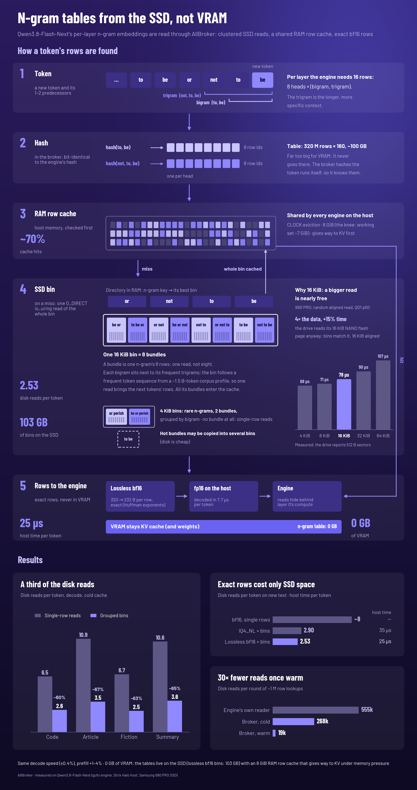

# N-gram tables from the SSD (Qwen3.8-Flash-Next)



Qwen3.8-Flash-Next adds a per-layer n-gram embedding: for every token it gathers 16 rows (8 heads × bigram and
trigram) from a ~100 GB table, picked by hashing the token with its predecessors. The rows are needed once per token
and the table is far too large for VRAM, so AllBroker serves it from the SSD with a RAM row cache. Qwen3.8-27B has no
such table; this applies to Flash-Next only.

**The tables never go to VRAM, even when VRAM is free.** A row is touched once per token and its read hides behind
the first layer's compute, so VRAM spent on the table buys no speed; the same VRAM as KV cache serves more agents
and longer contexts. In host RAM the row cache competes with the KV tier and gives way first under memory pressure.

## How it works

1. **Hashing in the broker.** Engines send token runs (two tokens of history plus the new tokens); the broker computes
   the row indices itself, bit-identical to the engine's hash, so it knows which n-grams a request touches.
2. **Bundles.** The 8 rows of one frequent bigram or trigram are stored together, so one n-gram costs one read
   instead of eight.
3. **Grouped bins.** A bigram's bundle sits next to its frequent trigram bundles, and each 16 KiB bin follows a
   frequent token sequence from a corpus profile (about 1.5 billion tokens). Reading one bin usually brings the next
   tokens' rows with it. Rare n-grams live in 4 KiB bins, grouped by bigram; hot bundles may appear in several bins
   (disk space is cheap).
4. **One shared cache.** Every bundle of a bin that was read enters the broker's row cache (set-associative, CLOCK),
   shared by every engine process on the host. Reads use O_DIRECT through io_uring, never under the index lock.
5. **Lossless bf16 rows.** The original bf16 rows, compressed losslessly (exponent offsets Huffman-coded) from 320 B
   to 232 B per row, decode straight to fp16 on the host in 7.7 µs per token. Per token they needed no more disk reads
   than 4-bit rows in our runs.

## Results

All numbers are from Qwen3.8-Flash-Next on a Strix Halo host with a Samsung 990 PRO SSD, using the gufo engine
with the broker as its n-gram reader.

**Grouped bins vs single-row reads** (disk reads per token, cold cache, held-out text):

| Text | Decode: single rows | Decode: bins | Change | Prefill: single rows | Prefill: bins | Change |
|---|---:|---:|---:|---:|---:|---:|
| Code | 6.49 | **2.59** | −60% | 4.14 | **1.69** | −59% |
| Article | 10.87 | **3.54** | −67% | 8.89 | **3.74** | −58% |
| Fiction | 6.74 | **2.48** | −63% | 7.14 | **2.85** | −60% |
| Summary | 10.55 | **3.65** | −65% | 8.98 | **3.41** | −62% |

Most of the remaining reads are single rows of rare trigrams that have no bundle.

**Table formats** (broker with bins and an 8 GiB row cache, new text after a warm-up):

| Format | Row size | Disk reads per token | Cache hit rate | Host time per token | Row error |
|---|---:|---:|---:|---:|---:|
| bf16, single rows (no bins) | 320 B | ~8 | 50% | — | exact |
| IQ4_NL + bins | 90 B | ~2.9 | 62% | 35 µs | 7.6% rms |
| **Lossless bf16 + bins** | 232 B | **2.53** | **70.8%** | **25 µs** | **exact** |

The bf16 and IQ4 rows come from warm-ups of 300 k tokens; the lossless row from a 2 M-token warm-up and a larger
bin layout (20 M bigram + 30 M trigram bundles), so read it as "no worse than IQ4", not as a gain of its own. Quality
against IQ4: next-token loss was within noise; the output distribution moved closer to bf16 (KL(bf16 ‖ IQ4) =
0.011, top-1 agreement 96.6%), about twice what rounding noise alone causes. The cost is SSD space: the lossless
bins file is 103 GB.

**Why lossless compression helps the read count:** 232 B rows pack 8 bundles per 16 KiB bin instead of 6, and 2
per 4 KiB bin instead of 1, so the same RAM cache holds 31% more rows.

**Quality of bf16 against IQ4_NL rows.** Exact rows remove IQ4's 7.6% row error. The effect on the model's outputs
is measurable as a distribution shift but too small to show up in loss, so we make no benchmark claim for it:

| Test | IQ4_NL rows | bf16 rows | Difference |
|---|---:|---:|---|
| Paired NLL, 50 k tokens of public text | 1.52099 | 1.52050 | −0.0005 (95% CI −0.0021 to +0.0012), not significant |
| Paired NLL, 8 public 4 k-token texts | 1.23473 | 1.23352 | −0.0004 ± 0.0020, not significant |
| KL divergence from the bf16 run (1,000 positions) | 0.011 (top-1 agreement 96.6%) | 0 | |
| Noise reference: a rounding-level fp16 change | 0.006 (97.4%) | | |
| For scale: 6-bit rows (1.7% row error) | 0.0072 (97.1%) | | |

IQ4 rows move the outputs about twice as far as rounding noise; bf16 rows remove that drift at no speed cost.

**Against the engine's own reader** (disk reads per round of about 1 M row lookups, live engine):

| Reader | Disk reads |
|---|---:|
| Engine's own reader (8 MB direct-mapped cache) | 555 k |
| Broker, cold | 268 k |
| Broker, warm (98% cache hits) | **19 k** |

**End to end:** decode speed unchanged (within 0.4%), prefill +1–4% (TTFT 5.60 → 5.38 s on fiction). The reads were
already hidden behind layer 0; the gain is a far lighter load on the SSD and RAM, which the KV tier shares.

**RAM cache budget** (lossless bf16 + bins, 2 M warm-up tokens, 100 k new tokens measured):

| Row cache | 2 GiB | 4 GiB | 8 GiB | 16 GiB | 24 GiB |
|---|---:|---:|---:|---:|---:|
| Hit rate | 56.8% | 62.8% | 67.4% | 67.6% | 67.6% |
| Disk reads per token | 3.51 | 3.35 | 3.17 | 3.17 | 3.17 |
| Host time per token | 43 µs | 40 µs | 31 µs | 29 µs | 28 µs |

The working set was about 7 GiB, so 8 GiB is the knee (this curve used an earlier bin layout than the 2.53 row above).

## Regenerating the graphic

`docs/charts/ngram_tables.py` draws the whole graphic, the diagram on top and the result panels below (matplotlib 3.9; fonts: Barlow, OFL, in `docs/charts/fonts/`):

```
cd docs/charts && python3 ngram_tables.py ../img   # -> ../img/ngram-ssd-tables.png / .svg
```
